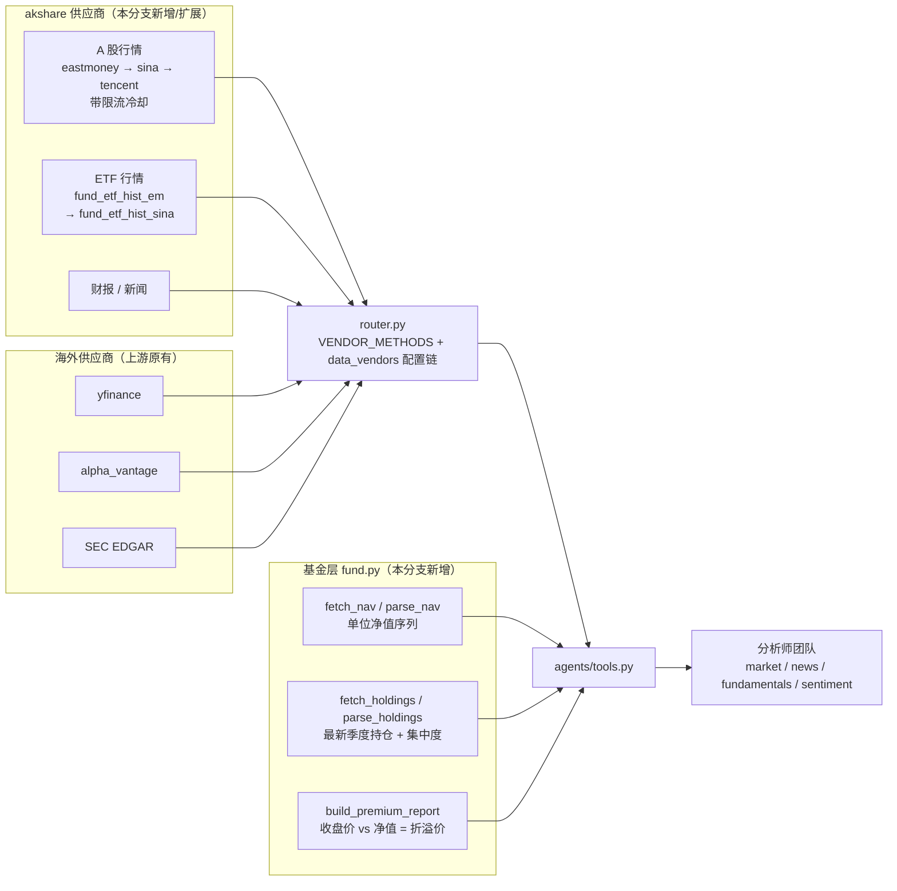
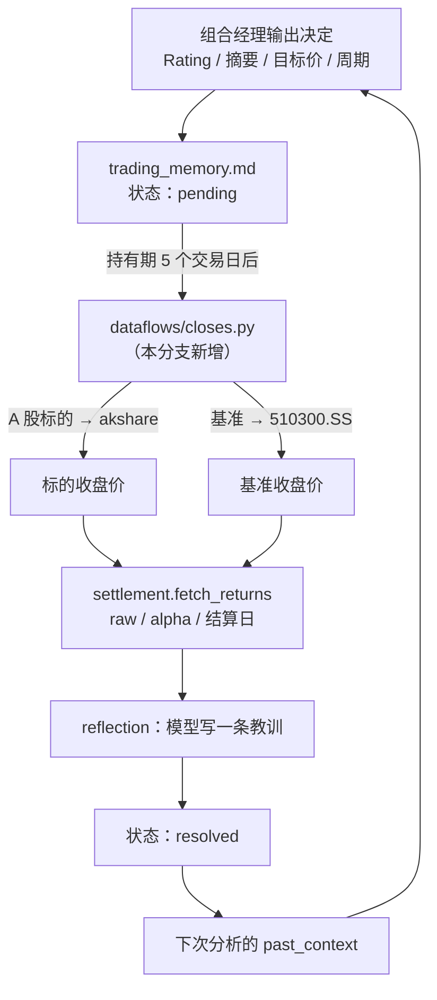

# TradingAgents-Plus：面向 A 股的分支

> 上游 [TradingAgents](https://github.com/TauricResearch/TradingAgents) v0.7.1（`272ad6e`）的私有分支，
> 只做两件事：**让 A 股数据可信**，**让每次决策都能被复盘**。

这个分支不是通用框架的另一起点。它保留上游的多智能体结构、报告格式和 CLI，
把「数据源」和「结算口径」这两层换成了在本机实际能跑通的做法。跑的是 A 股（股票、ETF），
服务对象是一个「次日交易许可单」网站，网站把分析任务交给宿主机 worker，worker 再调本项目。

上游文档（英文、通用介绍）在本仓库的 git 历史里：`git show origin/main:README.md`，
或直接看 https://github.com/TauricResearch/TradingAgents 。本文件只讲这个分支，不重复上游内容。

---

## 一、和上游的差异

| 方面 | 上游 | 本分支 |
| --- | --- | --- |
| A 股行情 | 依赖 Yahoo（`.SS`/`.SZ`），常被限流 | 新增 akshare 供应商：股票走东财 → 新浪 → 腾讯，ETF 走基金接口 |
| ETF 行情 | 按股票代码猜交易所，5xx 开头会被拼成 `sz`，新浪直接拒绝 | 识别基金代码（`_is_fund`），改用 `fund_etf_hist_em` → `fund_etf_hist_sina`，5xx 归上交所 |
| 基金层数据 | 无 | 新增 `vendors/akshare/fund.py`：单位净值、最新持仓与集中度、折溢价 |
| 分析师工具 | 行情、指标、财报、新闻 | 再加 `get_etf_nav` / `get_etf_holdings` / `get_etf_premium` |
| 结算取价 | `settlement.py` 写死 import 雅虎 `get_closes` | 新增 `dataflows/closes.py`：A 股走 akshare，其余走雅虎；A 股指数代码显式拒绝 |
| A 股 alpha 基准 | 上证综指/深证成指的**指数代码**（在雅虎取不到） | 沪深300ETF `510300.SS`（走 akshare 基金接口，可稳定取到） |
| 默认数据供应商 | `yfinance` 优先 | `akshare,yfinance`（核心行情与新闻）、`sec_edgar,akshare,yfinance`（财报） |

一句话概括：**上游假设你能拿到雅虎的数据；本分支假设你拿不到，于是把 A 股那条路换成了国内源。**

---

## 二、架构

### 2.1 数据链路



两条路要分清：

- **行情/财报/新闻**走 `router.py`，按 `data_vendors` 配置的顺序逐个试，失败返回 `DATA_UNAVAILABLE` 文本；
- **基金层**（`get_etf_*`）由 `tools.py` 直接调 `fund.py`，不经过 router——因为它读的是基金站，限流影响小，也不需要跨供应商回退。

### 2.2 决策与记忆闭环



这条链就是本分支存在的主要理由。原状是**断的**，而且断得很安静：

| 断点 | 原状 | 现在 |
| --- | --- | --- |
| 取价 | 写死走雅虎 → A 股被限流 → 抛 `VendorUnavailableError` | A 股走 akshare |
| 基准 | `.SS`/`.SZ` 映射到指数代码 → 雅虎取不到 → 照样失败 | 换成 ETF `510300.SS`，走 akshare |
| 可见性 | 异常被吞，只在报告头写一行 `Memory log: N past decision(s) could not be settled` | 失败仍明确记录（不伪装成功）；取价通后该行自然消失 |

为什么基准不用指数：`000001` 当**指数**是上证综指，当**股票**是平安银行；akshare 的股票接口
拿到这个代码会返回平安银行。拿它当大盘，等于拿一只银行股当基准，还不报错。
所以 `closes.py` 对 A 股指数代码**直接抛错**，宁可结算失败，也不给一份错的成绩单。

代价是 alpha 口径变了：历史教训里「相对上证综指」的旧记录，和新记录不能直接横向比较。

---

## 三、数据源与路由

### 3.1 配置在哪

`tradingagents/default_config.py`：

```python
"data_vendors": {
    "core_stock_apis":      "akshare,yfinance",
    "technical_indicators": "akshare,yfinance",
    "fundamental_data":     "sec_edgar,akshare,yfinance",
    "news_data":            "akshare,yfinance",
    "macro_data":           "fred",
    "prediction_markets":   "polymarket",
},
"tool_vendors": {},   # 单工具覆盖，优先级高于分类
```

`tool_vendors` 里写 `"get_stock_data": "alpha_vantage"` 就能只改一个工具。
链的顺序就是回退顺序；没列出的供应商**不会**被偷偷使用。

### 3.2 失败语义

| 返回 | 含义 | 分析该怎么用 |
| --- | --- | --- |
| `DATA_UNAVAILABLE: ...` | 所有供应商都限流或不可达 | 如实说数据不可用，不准估算 |
| `NO_DATA_AVAILABLE: ...` | 供应商答复了，但没有该标的的可用数据 | 同上，可能是代码错、退市、无覆盖 |
| 正常文本 | 有数据 | 正常引用 |

限流处理：akshare 供应商带进程内冷却（`_on_cooldown` / `_start_cooldown`），
命中一次限流后短期跳过该上游，下次调用直接走下一个；`market.reset_cooldowns()` 可手工清空。

---

## 四、A 股 / ETF / 基金层

### 4.1 新增工具

| 工具 | 用途 | 主要来源 |
| --- | --- | --- |
| `get_etf_nav` | 单位净值序列（默认回看 90 天），看市价是否跟着净值走 | `fund_etf_fund_info_em` |
| `get_etf_holdings` | 最新季度前十大持仓与集中度（top3 / top10） | `fund_portfolio_hold_em` |
| `get_etf_premium` | 折溢价（默认回看 30 天）：用收盘价与净值自行对齐计算 | 行情 + 净值 |

三个工具只对基金代码生效（`5xxxxx` / `1xxxxx`）；对股票调用会明确返回「不是基金」。

### 4.2 明确没有的能力

- **份额与规模变化**：需要 `fund_etf_spot_em`，走 push2 快照，限流严重，未接入；
- **资金流**（申购赎回、大单流入）：同上，未接入；
- **跟踪误差**：需要指数序列，本分支不取指数（见上文为什么），未接入；
- **持仓时效**：只有最新披露季度（当前是 Q3），不是实时持仓。

所以对 ETF 的结论应当看成「净值 + 折溢价 + 集中度」这三件事，而不是完整的基金研究。

---

## 五、结算与自我复盘

### 5.1 参数

| 项 | 默认值 | 位置 |
| --- | --- | --- |
| 持有期 | 5 个交易日 | `holding_period_days` |
| A 股基准 | `510300.SS` | `benchmark_map[".SS"]` / `[".SZ"]` |
| 美股基准 | `SPY` | `benchmark_map[""]` |
| 其它市场 | 各自指数 | `benchmark_map` 其余条目 |

### 5.2 结算怎么算

`fetch_returns(ticker, trade_date, holding_days, benchmark)`：

1. 从 `trade_date` 之后第一个收盘价入场；
2. 数满 `holding_days` 个交易日出场；
3. 计算标的收益 `raw` 与基准收益，差值为 `alpha`；
4. 当日未收盘的 bar 会被丢掉（`_by_day` 里按日期切），避免用未走完的 K 线结算；
5. 持有窗口还没走完 → 返回全 `None`，保持 pending，下次再试。

然后在 `settle_pending` 里为每条到期决策调一次 reflection（模型写教训），成功后状态转 `resolved`。

### 5.3 什么时候会失败

- ETF 或股票的上游同时限流 → `VendorUnavailableError` → 该条记为失败，留在 pending；
- reflection 调用失败 → 同样留 pending；
- 两条都不会打断正在跑的分析：`_memory_step` 捕获异常，把数量写进报告头的 `Memory log:` 一行。

---

## 六、运行

### 6.1 命令行

```bash
# 交互式
tradingagents

# 非交互（脚本/定时任务）
TRADINGAGENTS_LLM_PROVIDER=openai_compatible \
TRADINGAGENTS_QUICK_THINK_LLM=deepseek-v4.1-flash-1017 \
TRADINGAGENTS_DEEP_THINK_LLM=deepseek-v4.1-flash-1017 \
tradingagents --ticker 600009.SS --date 2026-11-19 \
  --analysts market,news,fundamentals --save --no-show
```

`--analysts` 只开实际用到的三个（market / news / fundamentals）；sentiment 需要额外的社媒数据源，
A 股场景下通常关掉。

### 6.2 被网站 worker 调用

网站侧不直接跑本项目，而是由宿主机 worker 起一个子进程：

```
网站（Docker）──入队──> worker（systemd）── Popen ──> relay_launcher.py ──> cli.main
                                                          │
                                                          └─ progress_hook 写 JSONL
                                                              （网站实时显示阶段）
```

`relay_launcher.py` 和 `progress_hook.py` 放在**网站仓库**的 `deploy/tradingagents/`，
不在本仓库；它们通过环境变量（`TA_REPO` / `TA_DATA` / `NOPLAN_PROGRESS_FILE`）与这里对接。
改动它们属于网站侧工作，改这里属于引擎侧工作，两边不要混。

### 6.3 产物

每次分析一个目录：`.runtime/logs/reports/<TICKER>_<YYYYMMDD>_<HHMMSS>/`

```
1_analysts/    market.md  news.md  fundamentals.md  (sentiment.md 仅在启用时)
2_research/    bull.md  bear.md  manager.md
3_trading/     trader.md
4_risk/        aggressive.md  conservative.md  neutral.md
5_portfolio/   decision.md
complete_report.md     # 合并版，头部含数据供应商与 Memory log 状态
```

`5_portfolio/decision.md` 是最下游事实来源：网站只解析它的
`**Rating**` / `**Executive Summary**` / `**Price Target**` / `**Time Horizon**` 四个字段。
改这里任何格式，先确认网站那边的解析规则（见网站仓库的 `worker/analysis_worker.py`）。

---

## 七、目录结构（只列与本分支相关的部分）

```
tradingagents/
├── agents/
│   ├── tools.py                  # 工具集；含 get_etf_nav/holdings/premium
│   └── analysts/market_analyst.py # 市场分析师：接入 ETF 工具 + 提示
├── dataflows/
│   ├── router.py                 # 供应商注册与回退
│   ├── closes.py                 # [新增] 结算取价：A股→akshare，指数拒绝
│   ├── symbols.py                # 代码规范化（.SH → .SS 等）
│   └── vendors/
│       ├── akshare/
│       │   ├── market.py         # 行情：股票链 + ETF 链 + 限流冷却
│       │   ├── symbols.py        # A 股代码判定与交易所推断
│       │   ├── fund.py           # [新增] 净值 / 持仓 / 折溢价
│       │   ├── fundamentals.py   # 财报
│       │   ├── news.py           # 新闻
│       │   └── guards.py         # 只接受 A 股标的的守卫
│       └── yahoo/ ...            # 上游原有
├── memory/
│   └── settlement.py             # 结算；import 已切到 closes.py
└── default_config.py             # data_vendors / benchmark_map
```

---

## 八、测试

```bash
cd D:\workspace\trade\TradingAgents
PYTHONDONTWRITEBYTECODE=1 .venv/Scripts/python.exe -m pytest -q \
  -p no:cacheprovider --basetemp=D:/workspace/noplan-prohibit/cache/tests/.tmp/ta
```

- 全量基线（2026-11-20）：**1489 passed / 6 skipped**（52 秒）；
- 与本分支改动直接相关的：`tests/test_closes_routing.py`（取价路由与指数拦截）、
  `tests/test_akshare_fund.py`（基金层）、`tests/test_akshare_vendor.py`（行情链与限流）。
- 两个必须的参数：`--basetemp` 指到工作区内（否则本机沙箱拒绝写系统临时目录）、
  `PYTHONDONTWRITEBYTECODE=1`（否则会往引擎目录写 `__pycache__`）。

---

## 九、已知限制

1. **A 股指数不能当标的**：会被 `closes.py` 拒绝；当基准也不行（已改成 ETF）。
2. **港股/美股仍走雅虎**：雅虎不可用时，这些标的的结算依旧失败（本次只修了 A 股）。
3. **基金层有缺口**：份额、资金流、跟踪误差未接入；持仓是季度披露，会滞后。
4. **限流会传导**：东财/新浪/腾讯任一限流都会降级或失败，属于外部依赖的固有风险。
5. **akshare 未写进 `pyproject.toml`**：重建 venv 会缺包，需要手工 `pip install akshare`。
6. **同一记忆文件多进程并发**：靠 `.settle.lock` 串行化结算，多 worker 时要注意。
7. **无 token / 成本账**：一次分析花了多少 token、多少钱，本项目不记录。

---

## 十、与上游同步

远端有两个：

```bash
git remote -v
# origin   https://github.com/TauricResearch/TradingAgents.git   ← 上游，只读
# private  git@github.com:18acgY/TradingAgent-Plus.git            ← 自己的仓库，可写
```

- 拉上游更新：`git fetch origin`，看 `git log --oneline origin/main..private/main` 里自己的补丁；
- 推自己的改动：`git push private main`（推 `origin` 会失败，没有写权限）；
- **升级会丢的补丁**（都在本文件「和上游的差异」表里）：akshare 供应商、ETF 链、基金层、
  `closes.py`、`settlement.py` 的 import、`default_config.py` 的基准与供应商顺序、
  以及 `tests/test_memory_log.py` 里被改写的 3 处基准断言。
  升级后请重跑一次 `tests/test_closes_routing.py` 与 `tests/test_akshare_fund.py`。

---

## 许可证

Apache License 2.0，沿用上游（见 `LICENSE`）。