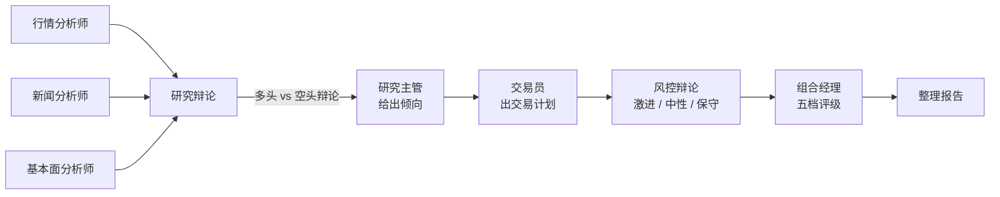
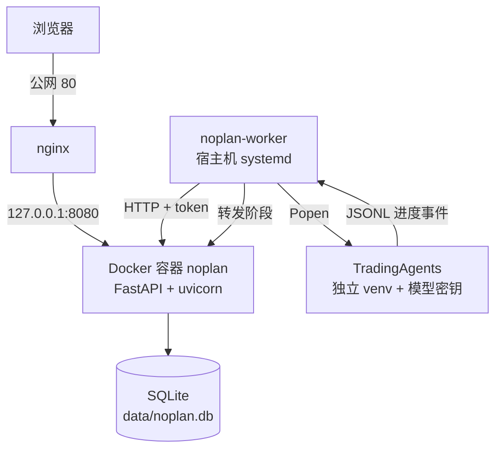

# 次日交易许可单（noplan-prohibit）

> **先填计划，再谈价格。**
>
> 仓库名 `noplan-prohibit` 就是这个意思：没有计划，禁止动手。

一个把「随手单」关在交易之外的纪律工具：每笔交易先填一张《次日交易许可单》，通过自动预审才允许下单；
再配一套**多智能体 AI 分析**，在填单前把「这只票到底怎么样」讲清楚。

- 单文件 SQLite + Docker，一条命令起站
- AI 分析跑在宿主机 worker 上，由 TradingAgents（LangGraph 多智能体框架）驱动
- 分析全程可见：真实阶段进度、随时可取消、同一天不重复花钱

### 运行截图


---

## 它解决什么问题

亏损常常不是选股选错，而是**下单这个动作没被管住**：

1. **先想买，再找理由**——理由是在下单冲动之后补的；
2. **盘中临时起意**——看到拉升、听到消息、怕踏空，当场改计划；
3. **没有退出规则**——不知道什么情况该认错，亏了就想「再等等」。

所以这个项目不预测涨跌，只管一件事：**没有提前写好的计划，就不许主动下单**。
许可单必须在计划交易日的前一个交易日填写；当天临时补单视为无效。

## 功能一：许可单与自动预审

一笔交易一张单，字段照搬原 Excel 表的全部内容：

- **交易逻辑**：一句话核心逻辑、客观证据、反方观点（什么情况说明你可能看错）
- **市场环境评分（100 分）**：大盘 30 + 板块 30 + 个股 30 + 组合相关性 10
- **交易参数**：买入价、启动低点（止损点）、主压力位、计划数量
- **触发 / 取消 / 退出条件**：写清楚什么情况才下单、什么情况放弃、什么情况止盈止损
- **8 项情绪检查**：踏空、眼红、恐惧回本、临时起意、追价改计划……任一项选「是」即红灯
- **承认错误信号**：如果判断错了，依据什么客观信号认错

页面边填边算（预计金额、止损距离、风险额、上涨空间、盈亏比、预算检查），保存时服务端用同一套公式复核。
然后按原表 A38 的五段判断自动预审：

| 顺序 | 判断                                                         | 结论                               |
| ---- | ------------------------------------------------------------ | ---------------------------------- |
| 1    | 日期闸门（demo 暂未启用）                                    | 不合规 → 禁止交易                  |
| 2    | 资料不完整                                                   | 红：「资料不完整：禁止交易」       |
| 3    | 情绪 8 项任一「是」                                          | 红：「纪律红灯：禁止交易」         |
| 4    | 参数门槛不达标（上涨空间 < 15%、盈亏比 ≤ 2、止损点 ≥ 买入价、目标价 ≤ 买入价、超预算） | 红：「参数未达个人门槛：禁止交易」 |
| 5    | 总分 < 60                                                    | 黄：「预审通过但禁止重仓：仅轻仓」 |
| 6    | 其余                                                         | 绿：「预审通过：仅按单执行」       |

三个门槛（上涨空间 15%、盈亏比 2、总分 60）可在「我的交易参数」里改，改完立即影响预审。
另有一页只读的「交易纪律」10 条，是整个工具的规则底座。

## 功能二：AI 分析（重点）

在许可单详情页点「运行分析」，按证券代码把这只票交给 TradingAgents 跑一轮研究，结果摘要回写详情页，
可点开完整报告。**AI 不替你下单，只负责把决策所需的信息摆齐**。

### 和「直接问大模型一句」有什么不同

不是一次问答，而是一条**多智能体流水线**：几个角色各干各的活，互相辩论，最后有一个角色拍板。
它更慢（单次 8–20 分钟）、更贵，换来的是结论有过程、可追溯，而不是一段听起来很像样的话。

### 一次分析里发生了什么



- **分析师团队并行调研**：行情（技术面）、新闻（事件与宏观）、基本面（财务与估值），各自调用数据工具
- **研究辩论**：多头研究员和空头研究员审阅分析师报告，结构化互怼，把「赚的空间」和「踩的雷」摆到同一张桌上
- **交易计划**：交易员综合前面的结论，给出交易方向、时机与仓位思路
- **风控辩论**：激进、中性、保守三个风控角色从不同风险偏好挑刺
- **组合决策**：组合经理结合全部材料，给出最终五档评级——`Buy / Overweight / Hold / Underweight / Sell`
- **整理报告**：把整个讨论过程与结论汇编成完整报告

### 你能拿到什么

详情页和报告页会显示：

| 字段           | 说明                                                         |
| -------------- | ------------------------------------------------------------ |
| **评级**       | 组合经理的最终结论，五档（Buy / Overweight / Hold / Underweight / Sell），页面按绿 / 黄 / 红着色 |
| **一句话摘要** | Executive Summary                                            |
| **目标价**     | Price Target                                                 |
| **时间窗口**   | Time Horizon                                                 |
| **完整报告**   | 全流程报告，Markdown 渲染（标题、列表、表格、代码块都正常显示） |

分析进行中还能看到**真实阶段进度**，不是假百分比：

```
准备 → 分析师团队 → 研究辩论 → 交易计划 → 风控辩论 → 组合决策 → 整理报告
```

阶段由 TradingAgents 的 agent 状态实时驱动（比如研究辩论时显示「多头」「空头」谁在发言），
页面每 3 秒轮询原地刷新，并显示已用时间。**故意不给百分比和预计剩余**——单次 8–20 分钟波动太大，
估不准会误导。

### 为长任务做的工程处理

一次分析动辄十几分钟，不能塞进一次 HTTP 请求，所以网站只负责「排队 + 展示」，重活交给宿主机上的 worker：

| 问题        | 处理方式                                                     |
| ----------- | ------------------------------------------------------------ |
| 长任务      | 网站入队，worker 每 5 秒领取；同一只票同一天已在排队/运行中不重复建单 |
| 重复花钱    | 同 `ticker + 分析日` 已有成功结果直接复用；每日成功上限默认 10 次（只数 `done`） |
| worker 挂了 | worker 每 30 秒心跳，离线时页面按钮禁用并提示服务离线        |
| 分析卡死    | 超过 20 分钟强制终止，记为失败                               |
| 想中途停下  | 排队中和运行中都能取消；运行中是信号通知 worker 杀掉整个进程组，取消不消耗当日额度 |
| 失败了      | 不自动重试，停在出错阶段，页面给「重新分析」                 |
| 报告显示乱  | Markdown 渲染关闭 HTML 解析、拦掉 `javascript:` 链接，只做安全排版 |

分析全程都在宿主机上留档：每次运行有独立日志目录和报告目录，报告文件就是事实来源。

### AI 与纪律的边界

这是这个项目最刻意的设计：

- **AI 结论不改变预审**：报告写得再好，许可单资料不完整、情绪红灯、参数不达标，照样禁止交易；
- **AI 不写台账**：不碰「实际成交 / 偏离 / 复盘」，那是人的事；
- **固定标注「仅供参考」**：分析卡片上写死，不随评级变化；
- **没有有效许可单，报告只是阅读材料**。

换句话说：**纪律负责「能不能做」，AI 只负责「值不值得研究」**。

## 架构



- **网站**：FastAPI 单进程，只做登录、表单、队列与展示；数据就是一个 SQLite 文件，备份即 `cp`
- **worker**：纯标准库 Python，跑在宿主机（因为 TradingAgents 有自己的 venv 和 API Key），
  负责领取任务、拉起分析、转发进度、执行取消、回写结果
- **TradingAgents**：研究框架本体，worker 通过启动器 `relay_launcher.py` 调用，暴露 `--ticker` / `--date` / `--analysts` 等参数

任务状态机：

```
queued ──claim──> running ──finish(done / failed / cancelled)──> 结束
   │                  │
   └─取消────────────> cancelled <──── worker 杀进程组──────┘
```

## 技术栈

| 层     | 选型                                                      |
| ------ | --------------------------------------------------------- |
| Web    | FastAPI + Jinja2 + uvicorn                                |
| 数据库 | SQLite（建表 + 补列在启动时自动完成，升级不用手工迁移）   |
| 前端   | 原生 HTML / CSS / JS，无框架                              |
| 部署   | Docker Compose + 宿主机 nginx                             |
| AI     | TradingAgents（LangGraph 多智能体），自带 venv 与模型密钥 |
| worker | 标准库 Python + systemd                                   |

## 快速开始

本地预览：

```bash
python -m venv .venv
.venv/bin/pip install -r requirements.txt
NOPLAN_PASSWORD=你的密码 NOPLAN_SECRET=随便一串随机字符 NOPLAN_DB=./data/noplan.db \
.venv/bin/python -m uvicorn app.main:create_app --factory --host 127.0.0.1 --port 8000
```

打开 <http://127.0.0.1:8000>。本地没有 worker 时，点「运行分析」会提示服务离线。

部署到服务器（Docker + nginx + 宿主机 worker）的完整步骤见 [README](README.md#部署到服务器)。

测试：

```bash
.venv/bin/python -m pytest     # Windows: .venv\Scripts\python -m pytest
```

当前 **130 passed / 1 skipped**（共 131 个），覆盖预审公式、页面/接口、进度、取消、worker 与启动器回归。

## 已知限制

- 日期闸门未启用：demo 只记录填单日期，不判断「前一交易日」（需接交易日历）
- 暂无 Excel 导出与台账页（实际成交、偏离、复盘）
- 单用户、HTTP 明文、无 CSRF token——公开部署前必须补
- 证券代码不校验真伪
- worker 离线时，运行中的取消会停在「取消中…」，等 worker 回来才落定
- 阶段进度依赖 TradingAgents 侧的 `progress_hook`，升级 TA 后需确认 hook 仍能挂上

## 免责声明

本项目仅供个人研究与自用，**不构成任何投资建议**。

- AI 分析可能出错：模型会幻觉，数据源有延迟，报告的评级与目标价只代表一次研究过程，不是承诺；
- 预审通过不代表必须下单，只有计划交易日当天触发条件完整出现，才按计划价格和数量执行；
- 任何条件未满足，放弃交易。

## 许可证

Apache License 2.0，见 [LICENSE](LICENSE)。
